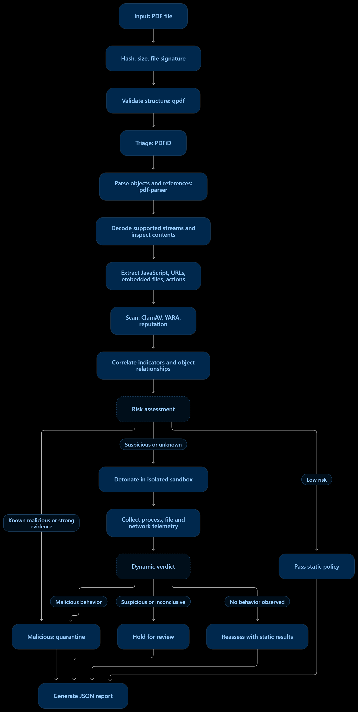

# PDF Static Advanced Security Analyzer (v1.1)
### *Hệ Thống Phân Tích Tĩnh Tệp Tin PDF Chuyên Sâu, An Toàn & Tự Động Xuất Báo Cáo Kép (Executive & SOC Analyst)*

---

## MỤC LỤC
1. [Giới Thiệu: Tại Sao Lại Có Dự Án Này?](#1-giới-thiệu-tại-sao-lại-có-dự-án-này)
2. [Kiến Trúc Hệ Thống & Luồng Xử Lý (Architecture)](#2-kiến-trúc-hệ-thống--luồng-xử-lý-architecture)
3. [Hướng Dẫn Cài Đặt & Cấu Hình Chi Tiết (Setup Guide)](#3-hướng-dẫn-cài-đặt--cấu-hình-chi-tiết-setup-guide)
   - [3.1. Thiết lập Ubuntu Server (Backend Engine)](#31-thiết-lập-ubuntu-server-backend-engine)
   - [3.2. Cấu hình Dịch vụ Nền systemd](#32-cấu-hình-dịch-vụ-nền-systemd)
   - [3.3. Thiết lập Windows Workstation (Client & Report Generator)](#33-thiết-lập-windows-workstation-client--report-generator)
4. [Hướng Dẫn Sử Dụng & Tùy Chọn Dòng Lệnh](#4-hướng-dẫn-sử-dụng--tùy-chọn-dòng-lệnh)
5. [Ví Dụ Thực Tế: Phân Tích Mẫu PDF Độc Hại / Đáng Ngờ](#5-ví-dụ-thực-tế-phân-tích-mẫu-pdf-độc-hại--đáng-ngờ)
   - [5.1. Dữ liệu đầu vào (Input Sample)](#51-dữ-liệu-đầu-vào-input-sample)
   - [5.2. Đầu ra Terminal trực quan](#52-đầu-ra-terminal-trực-quan)
   - [5.3. Cấu trúc JSON Tinh Gọn (`report_concise.json`)](#53-cấu-trúc-json-tinh-gọn-report_concisejson)
   - [5.4. Báo cáo PDF 2 Trang Hoàn Chỉnh (`report.pdf`)](#54-báo-cáo-pdf-2-trang-hoàn-chỉnh-reportpdf)
6. [Lộ Trình Cải Tiến Trong Tương Lai (Roadmap)](#6-lộ-trình-cải-tiến-trong-tương-lai-roadmap)

---

## 1. Giới Thiệu: Tại Sao Lại Có Dự Án Này?

### 1.1. Bối cảnh đe dọa (Threat Landscape)
Định dạng tệp **Portable Document Format (PDF)** là một trong những chuẩn tài liệu văn phòng phổ biến nhất toàn cầu, nhưng đồng thời cũng là **vector tấn công nguy hiểm bậc nhất** thường xuyên bị tin tặc (APT, Cybercriminals) lợi dụng trong các chiến dịch Spear-Phishing, phát tán mã độc tống tiền (Ransomware), đánh cắp tài khoản (Credential Harvesting) và khai thác lỗ hổng phần mềm đọc PDF (Adobe Acrobat, Foxit Reader,...).

Cấu trúc nội tại của PDF cực kỳ phức tạp: hỗ trợ nén nhiều tầng, stream dữ liệu nhị phân, nhúng tệp thực thi (`/EmbeddedFiles`), nhúng kịch bản lập trình (`/JavaScript`, `/JS`), cơ chế tự động thực thi khi mở file (`/OpenAction`, `/AA`), hành động gọi lệnh hệ điều hành (`/Launch`), mã QR đánh lừa người dùng (Quishing), và chuyển hướng trình duyệt (`/URI`).

### 1.2. Vấn đề của các phương pháp phân tích truyền thống
1. **Rủi ro khi phân tích động (Dynamic Execution):** Việc mở thử tệp PDF trên máy ảo reader có thể dẫn tới nguy cơ bị mã độc khai thác lỗ hổng zero-day/N-day, JavaScript kích hoạt kết nối ngầm đến máy chủ điều khiển (C2) làm lộ IP phân tích của tổ chức.
2. **Sự rời rạc của các công cụ phân tích tĩnh:** Các chuyên viên phân tích thường phải chạy thủ công hàng loạt công cụ dòng lệnh riêng lẻ (`pdfid`, `pdf-parser`, `qpdf`, `pdfdetach`, `strings`, `clamscan`,...). Mỗi công cụ trả về định dạng khác nhau, mất nhiều thời gian tổng hợp thủ công.
3. **Hiện tượng "Ô nhiễm thông tin" (Information Overload):** Đầu ra của các bộ phân tích tĩnh thường là các tệp JSON thô khổng lồ (từ 50 KB đến hàng megabyte), ngập tràn dữ liệu rác, bytecode nhị phân, khiến chuyên viên SOC mất nhiều giờ đồng hồ chỉ để tìm xem *đối tượng nào (`Object ID`)* thực sự chứa mã độc.
4. **Khoảng cách truyền thông giữa Kỹ thuật và Quản lý:** 
   - **Người dùng không chuyên (Non-tech) / Lãnh đạo doanh nghiệp:** Không thể hiểu được các thuật ngữ như `/Annots`, `/OpenAction`, Octal escape, QDF offset. Họ chỉ cần biết: *Tệp này có nguy hiểm không? Tại sao nguy hiểm? Cần xử lý thế nào ngay lập tức?*
   - **Chuyên viên SOC (SOC Analyst / Incident Responder):** Không thể chỉ nhận kết luận chung chung là "Suspicious" mà phải biết **chính xác vị trí đối tượng (Object ID, Stream offset, Reference Path, thuộc tính `/Annots/URI`)** để đưa ra bằng chứng pháp y, block rule tường lửa và truy vết EDR.

### 1.3. Sứ mệnh của PDF Static Advanced Security Analyzer
Dự án được ra đời nhằm giải quyết triệt để các vấn đề trên:
- **100% Phân tích tĩnh an toàn tuyệt đối (Zero Execution Risk):** Toàn bộ quá trình diễn ra trên máy chủ backend Ubuntu cô lập. Tuyệt đối không mở PDF trong reader, không chạy JavaScript engine, không gọi `eval`, không thực thi file nhúng và không thực hiện bất kỳ truy vấn mạng nào ra các URL tìm thấy.
- **Tái dựng Đồ thị Đối tượng (Object Reference Graph):** Lần theo cấu trúc phân cấp từ `/Root (Catalog)` đến từng node con để phát hiện chính xác chuỗi kích hoạt hành vi tĩnh.
- **Kiến trúc Báo Cáo Kép Đột Phá (Dual-Tier Reporting):** Tinh lọc file JSON thô khổng lồ thành bản tóm tắt tinh gọn chỉ **~6 KB (giảm hơn 91.7% dữ liệu thừa)** và tự động kết xuất ra **file PDF 2 trang chuẩn mực**, phục vụ song song cả người dùng không chuyên và chuyên gia SOC.

---

## 2. Kiến Trúc Hệ Thống & Luồng Xử Lý (Architecture)

Hệ thống được thiết kế theo mô hình **Client - Server phân tán**, phân tách rạch ròi giữa môi trường người dùng/SOC Analyst (Windows Workstation) và môi trường phân tích tĩnh độc lập (Ubuntu Server VM).

### 2.1. Sơ đồ Luồng Phân Tích Tổng Thể (Flowchart)
Dưới đây là sơ đồ chi tiết các bước xử lý từ khi tiếp nhận tệp PDF, phân tích qua các tầng công cụ, trích xuất đối tượng, cho đến khi kết xuất báo cáo:


### 2.2. Sơ đồ Kiến Trúc Tương Tác Giữa Các Thành Phần (Mermaid Architecture)
Mối quan hệ và luồng trao đổi dữ liệu giữa Windows Client, API Gateway, Storage, Sandboxed Engine và Report Generator:



### 2.3. Quy Trình Phân Tích 12 Giai Đoạn (12-Stage Pipeline)
1. **Intake & Hash Validation:** Kiểm tra kích thước tệp upload, kiểm tra magic header `%PDF-`, tính toán mã băm SHA-256 duy nhất cho phiên phân tích (Job ID).
2. **MIME & Structure Check:** Gọi `file` để xác định real MIME và `qpdf --check` để phát hiện lỗi cấu trúc tệp PDF.
3. **Metadata Extraction:** Dùng `pdfinfo` và `exiftool` trích xuất thông tin tác giả, phần mềm tạo (Word, InDesign,...), ngày tạo/sửa đổi.
4. **Keyword Triage:** Sử dụng `pdfid.py` (Didier Stevens) để đếm nhanh các từ khóa kích hoạt nguy hiểm (`/OpenAction`, `/JS`, `/JavaScript`, `/Launch`, `/EmbeddedFiles`, `/URI`).
5. **Object Inventory:** Dùng `pdf-parser.py` thống kê số lượng đối tượng gián tiếp (Objects), luồng dữ liệu (Streams).
6. **QPDF JSON Graph Reconstruction:** Xuất cây đối tượng dạng JSON v2 bằng QPDF, tái dựng đồ thị quan hệ (`Catalog /Root ➔ Pages ➔ Kids ➔ Annots ➔ Action /URI`).
7. **Stream Normalization (QDF):** Giải nén toàn bộ các stream bị nén FlateDecode/ASCIIHexDecode sang định dạng QDF chuẩn hóa để kiểm tra nội dung ở mức byte.
8. **JavaScript Static Analysis:** Trích xuất các luồng script, decode escape (`\xNN`, `\uNNNN`), khử ghép chuỗi nối literal (`"c" + "m" + "d"`), làm đẹp cú pháp với `jsbeautifier`, tìm kiếm URL và chỉ số mã độc mà không chạy mã.
9. **Embedded Files Inventory & Extraction:** Gọi `pdfdetach -list`, trích xuất từng file đính kèm vào đường dẫn được kiểm soát an toàn (`embedded_001.bin`), kiểm tra chữ ký magic bytes thực tế để phát hiện kỹ thuật đổi đuôi file kép giả mạo (`.pdf.exe`).
10. **Static QR Phishing Analysis (Tùy chọn):** Rasterize an toàn tối đa 5 trang đầu, dùng `zbarimg` giải mã mã QR để phát hiện thủ đoạn Quishing.
11. **Signature & YARA Scanning:** Quét chữ ký nhận diện mã độc bằng `clamscan` và tập luật `YARA` trên toàn bộ tệp PDF cũng như các file nhúng.
12. **Evidence Correlation & Dual-Tier Report Generation:** Tổng hợp toàn bộ bằng chứng, tính toán nhãn kết luận (`malicious`, `suspicious`, `low_risk`, `inconclusive`), sinh `report_concise.json` và biên dịch báo cáo đồ họa `report.pdf`.

---

## 3. Hướng Dẫn Cài Đặt & Cấu Hình Chi Tiết (Setup Guide)

### 3.1. Thiết lập Ubuntu Server (Backend Engine)
*Hệ điều hành khuyến nghị: Ubuntu 22.04 LTS / 24.04 LTS.*

#### Bước 1: Cài đặt các công cụ phân tích tĩnh cốt lõi
```bash
sudo apt update
sudo apt install -y file qpdf poppler-utils libimage-exiftool-perl clamav clamav-freshclam yara util-linux zbar-tools python3 python3-venv python3-pip
```

#### Bước 2: Cập nhật cơ sở dữ liệu mẫu ClamAV
```bash
# Kiểm tra dịch vụ cập nhật tự động freshclam
sudo systemctl status clamav-freshclam --no-pager

# Nếu dịch vụ chưa chạy, thực hiện cập nhật database thủ công:
sudo systemctl stop clamav-freshclam 2>/dev/null || true
sudo freshclam
sudo systemctl start clamav-freshclam
```

#### Bước 3: Cài đặt bộ công cụ Didier Stevens Suite
```bash
mkdir -p ~/malware_lab
cd ~/malware_lab
git clone https://github.com/DidierStevens/DidierStevensSuite.git

# Kiểm tra công cụ
python3 ~/malware_lab/DidierStevensSuite/pdfid.py --version
python3 ~/malware_lab/DidierStevensSuite/pdf-parser.py --version
```

#### Bước 4: Triển khai mã nguồn Backend & Cài đặt môi trường Python
```bash
cd ~
# Copy thư mục pdf-analyzer-backend vào thư mục người dùng:
cd ~/pdf-analyzer-backend

# Khởi tạo môi trường ảo Python
python3 -m venv .venv
source .venv/bin/activate
python -m pip install --upgrade pip
python -m pip install -r requirements.txt
python -m pip install -r requirements-dev.txt
```

#### Bước 5: Cấu hình biến môi trường và Token bảo mật
Tạo mã khóa API bí mật ngẫu nhiên:
```bash
export PDF_API_TOKEN="$(python3 -c 'import secrets; print(secrets.token_urlsafe(32))')"
printf 'PDF_API_TOKEN=%s\n' "$PDF_API_TOKEN"

# Bật tính năng quét mã QR nếu cần (Mặc định tắt):
export PDF_QR_SCAN_ENABLED=1
export PDF_MAX_QR_PAGES=5
```

---

### 3.2. Cấu hình Dịch vụ Nền systemd
Để dịch vụ tự động chạy ngầm, tự khởi động lại khi gặp sự cố hoặc reboot máy chủ:

#### Bước 1: Tạo tệp cấu hình bảo vệ Token
```bash
sudo install -d -m 700 /etc/pdf-analyzer
printf 'PDF_API_TOKEN=%s\nPDF_QR_SCAN_ENABLED=1\n' "$PDF_API_TOKEN" | sudo tee /etc/pdf-analyzer/pdf-analyzer.env >/dev/null
sudo chmod 600 /etc/pdf-analyzer/pdf-analyzer.env
```

#### Bước 2: Kích hoạt dịch vụ systemd
```bash
sudo cp ~/pdf-analyzer-backend/systemd/pdf-analyzer.service /etc/systemd/system/pdf-analyzer.service
sudo systemctl daemon-reload
sudo systemctl enable --now pdf-analyzer
sudo systemctl status pdf-analyzer --no-pager
```

Kiểm tra kết nối health check:
```bash
curl http://127.0.0.1:8000/health
# Kết quả mong đợi: {"status":"healthy", ...}
```

---

### 3.3. Thiết lập Windows Workstation (Client & Report Generator)
*Môi trường: Windows 10 / 11, PowerShell 5.1+ hoặc PowerShell 7.*

#### Bước 1: Cài đặt thư viện Python cần thiết
Mở PowerShell tại máy Windows và cài đặt các thư viện cần thiết:
```powershell
python -m pip install --upgrade pip
python -m pip install requests reportlab pillow pypdf
```

#### Bước 2: Thiết lập thông số kết nối API
```powershell
# Thiết lập địa chỉ IP của Ubuntu Server VM
$env:PDF_ANALYZER_URL = "http://192.168.140.133:8000"

# Thiết lập Token đã tạo ở bước cấu hình Ubuntu:
$env:PDF_API_TOKEN = "PASTE_TOKEN_FROM_UBUNTU_HERE"
```

---

## 4. Hướng Dẫn Sử Dụng & Tùy Chọn Dòng Lệnh

Dự án cung cấp 2 phương thức sử dụng linh hoạt:

### Cách 1: Gửi file PDF phân tích trực tiếp từ Windows Client (`client_windows.py`)
Gửi mẫu thử nghiệm qua REST API đến máy chủ Ubuntu, nhận kết quả và tự động xuất ra JSON tinh gọn cùng file PDF:
```powershell
# Phân tích và tự động xuất báo cáo PDF:
python .\pdf-analyzer-backend-v1.1\pdf-analyzer-backend\client_windows.py "C:\Samples\malicious.pdf" --pdf --out .\reports

# Chỉ lưu file JSON tinh gọn (bỏ qua file log thô):
python .\pdf-analyzer-backend-v1.1\pdf-analyzer-backend\client_windows.py "C:\Samples\malicious.pdf" --format concise --pdf
```

**Các tham số dòng lệnh chính:**
- `pdf`: Đường dẫn đến tệp PDF cần phân tích trên máy local.
- `--url`: URL của máy chủ API (Mặc định đọc từ biến `$env:PDF_ANALYZER_URL`).
- `--token`: Token xác thực Bearer (Mặc định đọc từ `$env:PDF_API_TOKEN`).
- `--format {full, concise, both}`: Định dạng lưu trữ JSON (Mặc định `both` lưu cả file thô và file tinh gọn).
- `--pdf`: Bật cờ này để tự động biên dịch báo cáo `_report.pdf`.
- `--out`: Thư mục lưu kết quả báo cáo.

---

### Cách 2: Sử dụng công cụ độc lập chuyển đổi file JSON sang PDF (`generate_pdf_report.py`)
Nếu bạn đã có sẵn file kết quả JSON thô (`report.json`) từ các lần phân tích trước hoặc từ hệ thống khác:
```powershell
# Tự động đọc file report.json, trích xuất report_concise.json và kết xuất report.pdf:
python generate_pdf_report.py report.json

# Chỉ định đường dẫn đầu ra theo ý muốn:
python generate_pdf_report.py "report.json" -o "C:\Reports\Incident_2026_Report.pdf" --json-out "C:\Reports\Incident_2026_Concise.json"
```

---

## 5. Ví Dụ Thực Tế: Phân Tích Mẫu PDF Độc Hại / Đáng Ngờ

Dưới đây là kết quả thực tế thu được từ mẫu tệp thử nghiệm trong dự án: `6ee17554545ebe2c31f1462e2758e1e16b0b5aacef1274ff6c57345b79eab1e2.pdf`.

### 5.1. Dữ liệu đầu vào (Input Sample)
- **Tên tệp gốc:** `6ee17554545ebe2c31f1462e2758e1e16b0b5aacef1274ff6c57345b79eab1e2.pdf`
- **Dung lượng:** 543,825 bytes (~544 KB)
- **Số trang:** 6 trang
- **Tác giả mạo danh trong metadata:** `Leah Berry`
- **Phần mềm tạo giả lập:** `Microsoft® Word 2019` / `Adobe PDF Services`

---

### 5.2. Đầu ra Terminal trực quan
Khi chạy lệnh `python generate_pdf_report.py report.json`, màn hình hiển thị trực tiếp cấu trúc phân tách rõ ràng:

```text
=================================================================
      PDF STATIC ANALYSIS — CONCISE EXECUTIVE & SOC REPORT
=================================================================
Sample File : 6ee17554545ebe2c31f1462e2758e1e16b0b5aacef1274ff6c57345b79eab1e2.pdf
SHA-256     : 6ee17554545ebe2c31f1462e2758e1e16b0b5aacef1274ff6c57345b79eab1e2
Verdict     : SUSPICIOUS (MEDIUM - HIGH)
-----------------------------------------------------------------
[1] DÀNH CHO CẤP QUẢN LÝ & NGƯỜI DÙNG (EXECUTIVE SUMMARY):
 • Nhận định : Tài liệu chứa liên kết mờ ám và kỹ thuật che giấu nội dung đáng ngờ.
 • Giải thích: Tệp PDF này tự nhận là tài liệu do 'Leah Berry' soạn thảo bằng 
               Microsoft® Word 2019 (dung lượng 543,825 bytes, gồm 6 trang). 
               Điểm đáng ngờ chính: Tài liệu đã cài cắm liên kết ngầm trỏ đến máy 
               chủ ngoài không rõ nguồn gốc:
               (https://deducationist.com/rejets_6bc7c1/zibethdisowntexter.php?Sabo=...). 
               Đây là dấu hiệu điển hình của thủ đoạn lừa đảo (phishing) nhằm chiếm 
               đoạt tài khoản hoặc lừa nạn nhân tải về mã độc. Đồng thời, cấu trúc bên 
               trong tệp chứa nhiều đoạn mã bị mã hóa che giấu bất thường (Base64/Hex/Octal) 
               - kỹ thuật tin tặc thường dùng để 'qua mặt' các phần mềm diệt virus.
 • Tác động  : Nguy cơ lừa đảo chiếm đoạt tài khoản (Phishing), lộ lọt thông tin 
               nhạy cảm hoặc bị cài cắm mã độc từ xa.
 • Khuyến nghị: Tuyệt đối KHÔNG mở file; Cách ly tệp; Liên hệ ngay đội SOC nếu đã bấm link.
-----------------------------------------------------------------
[2] DÀNH CHO SOC ANALYST (TECHNICAL OBJECT ATTRIBUTION):
 • [!] Flagged Object ID: 4 0 R (Tương tác / Liên kết (nested_action_type:/URI, uri_entry))
     Path   : 3 0 R (/Pages) ➔ 1 0 R (/Kids[0]) ➔ 4 0 R
     Trigger: Tương tác người dùng (User Click / Annotation Link)
     -> /Annots[0]/A: {"/S": "/URI", "/URI": "https://deducationist.com/..."}
     -> /Annots[0]/A/S: /URI
     -> /Annots[0]/A/URI: https://deducationist.com/rejets_6bc7c1/zibethdisowntexter.php?Sabo=vsbejyf63fwhrvbhk4u8wy7gerh
     -> /Annots[1]/A/URI: https://deducationist.com/rejets_6bc7c1/zibethdisowntexter.php?Sabo=vsbejyf63fwhrvbhk4u8wy7gerh
 • [!] Dấu hiệu Obfuscation: 11 Octal escapes, 46 khối Base64 chunks (offsets: 4057, 4369, 4570,...), 39 Hex strings.
 • [!] MITRE ATT&CK: T1204.002 (User Execution), T1027 (Obfuscation), T1566.002 (Phishing Link).
-----------------------------------------------------------------
[✓] Concise JSON Saved : report_concise.json (6.5 KB - Giảm 91.7% dữ liệu thừa)
[✓] Executive PDF Saved: report.pdf (Báo cáo vector 2 trang tiêu chuẩn)
=================================================================
```

---

### 5.3. Cấu trúc JSON Tinh Gọn (`report_concise.json`)
Thay vì phải lưu trữ file JSON thô hơn **78 KB**, file tinh gọn chỉ có dung lượng **6.5 KB**:

```json
{
  "metadata": {
    "job_id": "34afb95f-d85f-4004-b72f-e5d32fea4748",
    "timestamp_utc": "2026-11-08T07:27:51.755389+00:00",
    "analyzer_version": "1.1.0"
  },
  "sample": {
    "filename": "6ee17554545ebe2c31f1462e2758e1e16b0b5aacef1274ff6c57345b79eab1e2.pdf",
    "sha256": "6ee17554545ebe2c31f1462e2758e1e16b0b5aacef1274ff6c57345b79eab1e2",
    "size_bytes": 543825,
    "pages": "6",
    "author": "Leah Berry",
    "creator": "Microsoft® Word 2019"
  },
  "executive_summary": {
    "verdict": "SUSPICIOUS",
    "risk_level": "MEDIUM - HIGH",
    "badge_title": "ĐÁNG NGỜ - CẢNH BÁO BẢO MẬT",
    "confidence": "MEDIUM",
    "headline": "Tài liệu chứa liên kết mờ ám và kỹ thuật che giấu nội dung đáng ngờ.",
    "plain_explanation": "Tệp PDF này tự nhận là tài liệu do 'Leah Berry' soạn thảo bằng Microsoft® Word 2019... Tài liệu đã cài cắm liên kết ngầm trỏ đến máy chủ ngoài không rõ nguồn gốc...",
    "business_impact": "Nguy cơ lừa đảo chiếm đoạt tài khoản (Phishing), lộ lọt thông tin nhạy cảm hoặc bị cài cắm mã độc từ xa.",
    "recommendations": [
      "TUYỆT ĐỐI KHÔNG mở tài liệu hoặc nhấp vào bất kỳ đường link/nút bấm nào.",
      "Thực hiện cách ly/xóa tệp ngay khỏi hòm thư và thiết bị người dùng.",
      "Nếu đã nhấp vào liên kết, cần báo ngay cho bộ phận An toàn thông tin (SOC)."
    ]
  },
  "soc_technical_attribution": {
    "flagged_objects": [
      {
        "object_id": "4 0 R",
        "role": "Tương tác / Liên kết (nested_action_type:/URI, uri_entry)",
        "hierarchy_path": "3 0 R (/Pages) ➔ 1 0 R (/Kids[0]) ➔ 4 0 R",
        "trigger_mechanism": "Tương tác người dùng (User Click / Annotation Link)",
        "details": [
          {
            "field": "/Annots[0]/A/URI",
            "value": "https://deducationist.com/rejets_6bc7c1/zibethdisowntexter.php?Sabo=vsbejyf63fwhrvbhk4u8wy7gerh"
          }
        ]
      }
    ],
    "iocs": {
      "network": [
        {
          "type": "URL",
          "indicator": "https://deducationist.com/rejets_6bc7c1/zibethdisowntexter.php?Sabo=vsbejyf63fwhrvbhk4u8wy7gerh",
          "severity": "HIGH",
          "context": "Liên kết ngoại vi trỏ đến máy chủ ngoài (Cần chặn)"
        }
      ],
      "sample_sha256": "6ee17554545ebe2c31f1462e2758e1e16b0b5aacef1274ff6c57345b79eab1e2"
    },
    "obfuscation_analysis": {
      "techniques": [
        {"technique": "Pdf Octal Escape", "count": 11},
        {"technique": "Long Base64 Candidate", "count": 46},
        {"technique": "Long Hex String Candidate", "count": 39}
      ],
      "summary": "Phát hiện tổng cộng 96 vị trí sử dụng kỹ thuật mã hóa/che giấu."
    },
    "mitre_attack": [
      {
        "tactic": "Initial Access / Execution",
        "technique_id": "T1204.002",
        "technique_name": "User Execution: Malicious File",
        "evidence": "Tài liệu dụ dỗ người dùng tương tác với link/nút bấm ẩn trong trang."
      },
      {
        "tactic": "Defense Evasion",
        "technique_id": "T1027",
        "technique_name": "Obfuscated Files or Information",
        "evidence": "Phát hiện 3 cơ chế làm mờ chuỗi (Base64/Hex/Octal) trong stream."
      }
    ],
    "playbook_actions": [
      "Cấu hình chặn Domain [deducationist.com] trên Firewall / Web Proxy / DNS Sinkhole.",
      "Thực hiện Threat Hunting mã SHA-256 trên EDR/SIEM toàn tổ chức.",
      "Truy soát nhật ký DNS/Proxy trong 7 ngày gần nhất để phát hiện endpoint bị nhiễm."
    ]
  }
}
```

---

### 5.4. Báo cáo PDF 2 Trang Hoàn Chỉnh (`report.pdf`)
Báo cáo PDF được thiết kế chuyên nghiệp trên khổ giấy A4 tiêu chuẩn:
- **Trang 1 (Executive Summary):** 
  - Khối định danh tệp (Tên file, SHA-256, dung lượng, thời gian, tác giả).
  - Thẻ kết luận có viền và màu nền phân cấp mức độ nguy hiểm (Đỏ: Malicious, Cam: Suspicious, Xanh: Low Risk).
  - Khung diễn giải ngôn ngữ tự nhiên về bản chất cảnh báo và tác động kinh doanh.
  - Hộp khuyến nghị màu vàng với các việc cần làm ngay cho người dùng văn phòng và bộ phận IT.
- **Trang 2 (SOC Analyst Technical Attribution):**
  - Bảng định danh đối tượng nghi vấn: Liệt kê rõ `Object 4 0 R`, đường dẫn từ Catalog, cơ chế Trigger và các thuộc tính vi phạm.
  - Bảng chỉ số thỏa hiệp (IOCs): Bảng URL, Domain, Hash được phân loại mức độ `HIGH` / `INFORMATIONAL`.
  - Bảng phân tích kỹ thuật làm mờ (Obfuscation) và ánh xạ khung MITRE ATT&CK.
  - Bảng kiểm hành động ứng cứu sự cố (Incident Response Checklist) có sẵn checkbox cho chuyên viên SOC tích chọn trong quá trình điều tra.

---

## 6. Lộ Trình Cải Tiến Trong Tương Lai (Roadmap)

1. **Tích hợp Tự động hóa Môi trường Động (Dynamic Sandbox Hook):**
   - Tự động chuyển giao mẫu PDF sang Cuckoo Sandbox, CAPE Sandbox hoặc API của ANY.RUN khi phân tích tĩnh phát hiện thấy cơ chế kích hoạt nguy hiểm (`/OpenAction`, `/Launch`, `/EmbeddedFiles`).
2. **Làm giàu Dữ liệu Tình báo Mối đe dọa (Threat Intelligence Enrichment):**
   - Tự động truy vấn VirusTotal, AlienVault OTX và AbuseIPDB cho toàn bộ các URL, tên miền và mã băm SHA-256 trích xuất được từ PDF nhằm cung cấp chỉ số danh tiếng (Reputation Score) theo thời gian thực.
3. **Tự động Sinh Luật Phòng Thủ (Automated Detection Rule Generation):**
   - Tự động tạo luật YARA tùy biến, luật mạng Suricata / Snort và truy vấn tìm kiếm SIEM (Sigma Rules / Splunk SPL / Elastic KQL) từ chính các thuộc tính đối tượng và IOCs vừa phân tích.
4. **Trợ lý AI Phân Tích Cục Bộ (Local LLM Incident Summary):**
   - Tích hợp mô hình ngôn ngữ lớn chạy nội bộ (Ollama / Mistral / Llama 3) để tự động đọc dữ liệu JSON tinh gọn, soạn thảo bản báo cáo sự cố (Incident Ticket) chi tiết theo văn phong nghiệp vụ của từng cơ quan/doanh nghiệp.
5. **Giao Diện Trực Quan Web Dashboard (Interactive Web UI):**
   - Xây dựng dashboard đồ họa cho phép người dùng kéo thả tệp PDF cần kiểm tra, trực quan hóa cây quan hệ đối tượng bằng đồ thị tương tác D3.js và tải xuống file PDF báo cáo chỉ bằng một cú click chuột.
6. **Mô-đun Giải Mã Mật Khẩu Tự Động (Password Brute-Forcing for Phishing PDFs):**
   - Bổ sung từ điển các mật khẩu phổ biến thường được đính kèm trong nội dung email phishing (như `1234`, `password`, `invoice`, số điện thoại) để tự động mở khóa các tệp PDF được đặt mật khẩu bảo vệ trước khi đưa vào phân tích tĩnh.


## Author : Hoang Gia Khanh
